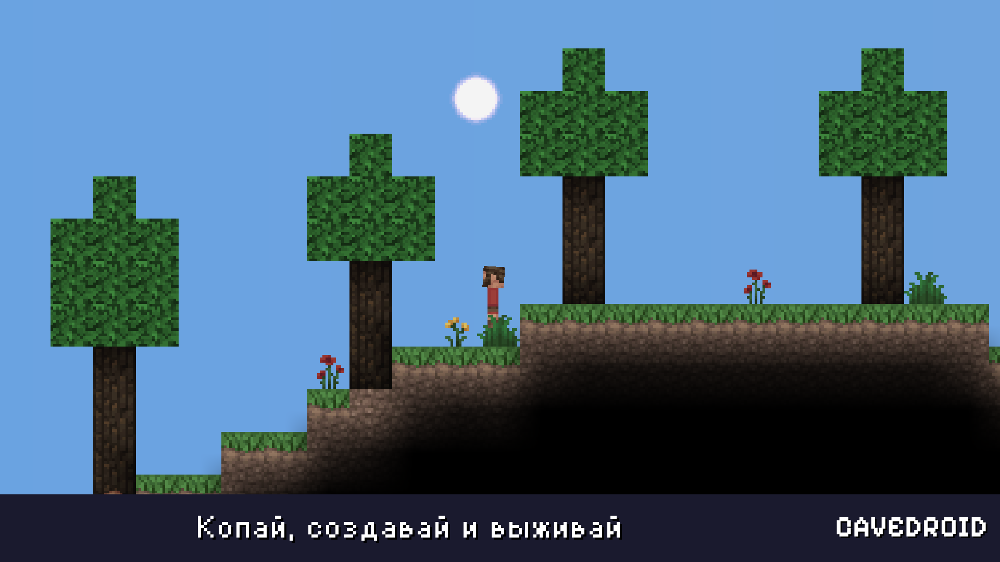
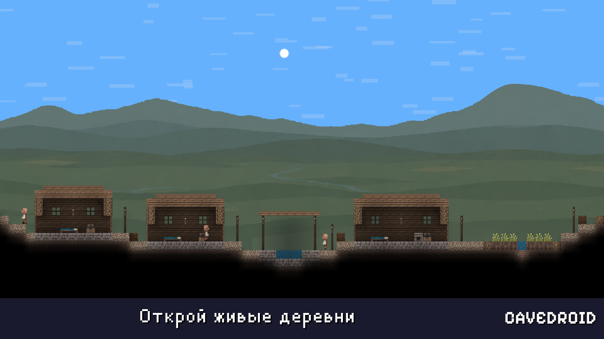
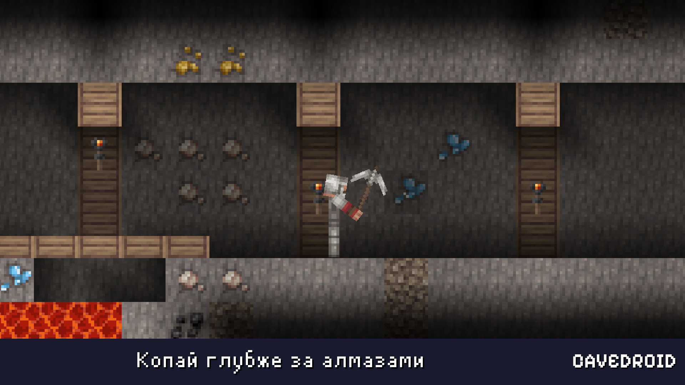
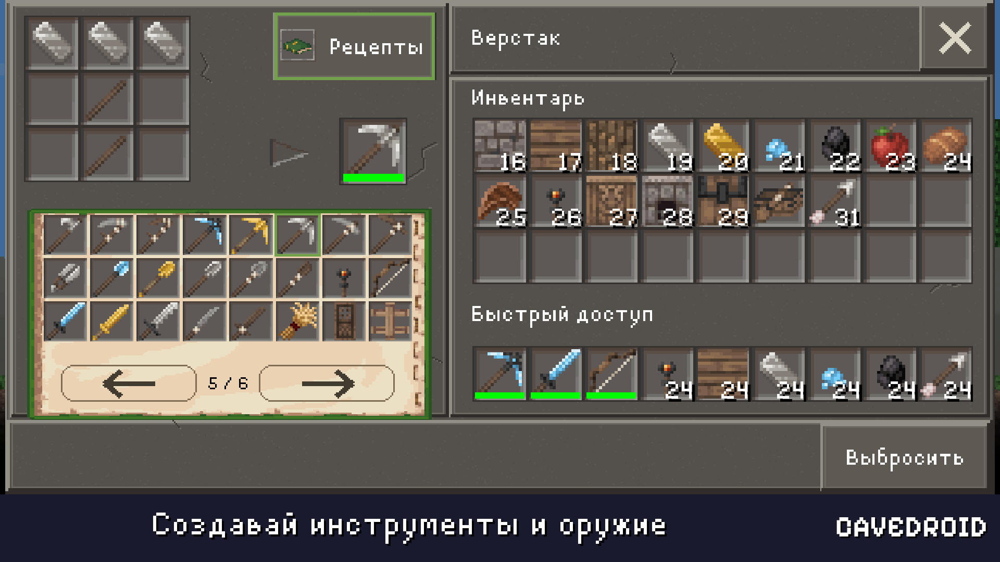
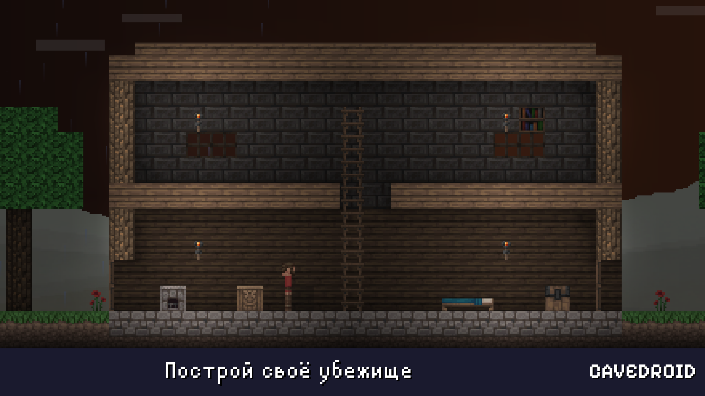

[English](README.md) | [Русский](README-RU.md)


[](https://github.com/fredboy/cavedroid/actions/workflows/android.yml)
[](https://github.com/fredboy/cavedroid/actions/workflows/desktop.yml)
[](https://github.com/fredboy/cavedroid/actions/workflows/html.yml)
[](https://github.com/fredboy/cavedroid/actions/workflows/ktlint.yml)
[](https://github.com/fredboy/cavedroid/releases)

CaveDroid — это **2D-игра в стиле Minecraft** для Android, Desktop (Windows, Linux, macOS), Web (браузер) и потенциально iOS.
Исследуйте, добывайте ресурсы и стройте в процедурно генерируемых мирах.

<details>
  <summary>Скриншоты</summary>









</details>

---

## Возможности

- **Режимы игры:** выживание со здоровьем и голодом; творческий режим с неограниченными блоками и полётом. Можно играть одному без интернета.
- **Исследование:** процедурно генерируемые бесконечные миры с биомами, пещерами, шахтами и деревнями. Лодки для передвижения по воде.
- **Крафт и строительство:** добыча и плавка руды, создание инструментов и блоков, обустройство домов и хранение запасов в сундуках.
- **Сельское хозяйство:** выращивание растений и приготовление еды.
- **Бой:** зомби, скелеты, пауки и криперы; мечи, луки, броня и динамит с цепными взрывами.
- **Симуляция мира:** текущая вода и лава, распространение огня.
- **Освещение и погода:** смена дня и ночи, свет от факелов, дождь, снег и замерзание воды в снежных биомах.
- **[Пакеты ресурсов](ASSET_PACKS.md):** свои текстуры, звуки и игровые данные на Android и компьютерах, включая текстуры высокого разрешения.
- **Сохранения:** несколько миров, экспорт и импорт сохранений.
- **Статистика:** время игры, добытые блоки, созданные предметы и другие игровые действия.

---

## Управление

| Действие | Сенсор / Мобильное | Клавиатура / Мышь |
|----------|--------------------|------------------|
| Движение влево/вправо | Тянуть **джойстик** на левой половине экрана | **A / D** |
| Прыжок | Нажать на левую часть или кнопку прыжка | **Пробел** (прыжок в воздухе в творческом режиме = полёт) |
| Движение курсора / прицеливание | Тянуть на правой стороне | Двигать **мышь** |
| Ломать блок | Удерживать на правой стороне | **ЛКМ** при наведении на блок |
| Разместить блок (задний слой) | Удерживать справа при наведении на пустую ячейку | **ПКМ** при наведении на пустое место |
| Активировать / Использовать / Разместить активный блок | Нажать справа | **ПКМ** |
| Атака моба | Нажать при наведении на моба | **ЛКМ** |
| Открыть инвентарь | Кнопка сундука | **E** |
| Инвентарь: взять / переместить | Drag-n-drop, нажатие | Клик для взять, ПКМ для половины стака или размещения по одному предмету |
| Инвентарь: переместить один предмет (сенсор) | Удерживать предмет одним пальцем + тапнуть по ячейке другим | Н/Д |

---

## Готовые сборки

<p>
  <a href="https://play.google.com/store/apps/details?id=ru.fredboy.cavedroid">
    
  </a>
    <br>
  <a href="https://www.rustore.ru/catalog/app/ru.fredboy.cavedroid">
    
  </a>
</p>


Сборки для Android и компьютеров также можно скачать на [странице релизов](https://github.com/fredboy/cavedroid/releases).
Или поиграть прямо в браузере [на GitHub Pages](https://fredboy.github.io/cavedroid).

---

## Сборка

Установите **JDK 25** и укажите его в `JAVA_HOME` и настройке Gradle JVM в IDE.
Для сборки Android также нужен Android SDK. Используйте Gradle wrapper из корня проекта:

| Задача | Команда |
| --- | --- |
| Запуск на компьютере | `./gradlew desktop:run` |
| Десктопный JAR | `./gradlew desktop:dist` |
| Отладочный APK FOSS | `./gradlew android:assembleFossDebug` |
| Запуск веб-версии (JavaScript / Wasm GC) | `./gradlew html:runWeb` / `./gradlew html:runWasm` |
| Веб-архив для статического хостинга (JavaScript / Wasm GC) | `./gradlew html:packageWebDist` / `./gradlew html:packageWebDistWasm` |

Веб-версия использует [gdx-teavm](https://github.com/xpenatan/gdx-teavm).
Для Wasm нужен браузер с поддержкой WebAssembly GC; JavaScript-версия поддерживает только конечные миры.
Дополнительные задачи сборки описаны в файлах `build.gradle.kts` соответствующих модулей.

В Windows используйте `gradlew.bat` и убедитесь, что симлинки на `assets/` корректны.

Для подписанных сборок создайте `keystore.properties` в корне проекта:

```properties
releaseKeystorePath=/path/to/keystore.jks
releaseKeystorePassword=...
releaseKeyAlias=...
releaseKeyPassword=...
```

Не добавляйте ключи и пароли в Git. Правила участия и проверки: [CONTRIBUTING.md](CONTRIBUTING.md).

## Пакеты ресурсов

Формат ZIP и правила переопределения ресурсов: [ASSET_PACKS.md](ASSET_PACKS.md) (на английском).

## Лицензия

### Код
CaveDroid распространяется под лицензией **MIT**. Подробнее см. [LICENSE](LICENSE).

### Ассеты

- **Текстуры**: Pixel Perfection от XSSheep, лицензия [CC BY-SA 4.0](https://creativecommons.org/licenses/by-sa/4.0/)
- **Экранный джойстик**: CC-0 с [OpenGameArt.org](https://opengameart.org/content/mmorpg-virtual-joysticks)
- **Шрифт**: LanaPixel от eishiya, лицензия [CC BY 4.0](https://creativecommons.org/licenses/by/4.0/)
- **Скрипты**: Разные скрипты с Stack Overflow, распространяются под соответствующими лицензиями

Лицензированные ассеты содержат файл `attribution.txt` с нужными упоминаниями.

---

## Вклад в проект

Мы приветствуем вклад в проект! Пожалуйста, создавайте issues или pull requests для предложений, исправлений ошибок или улучшений.
