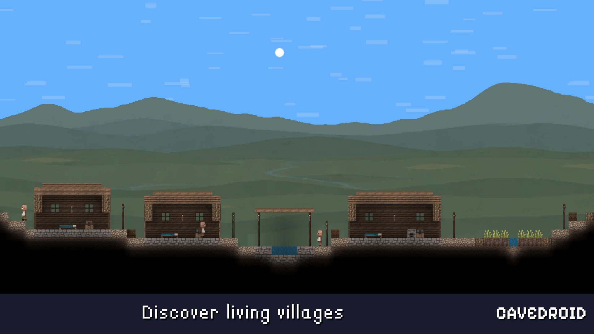
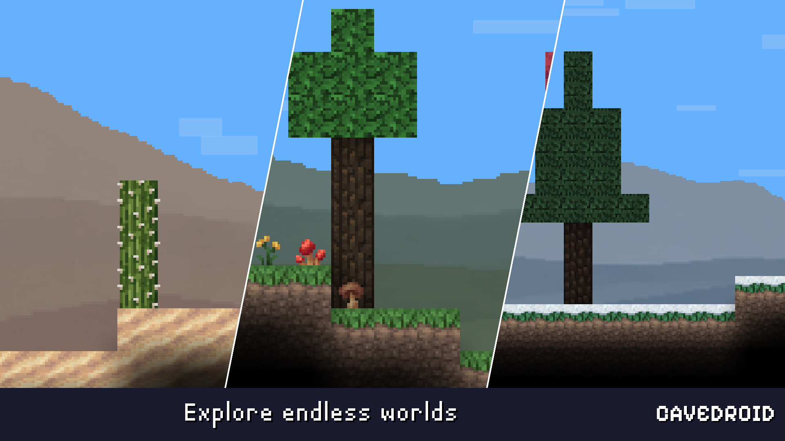
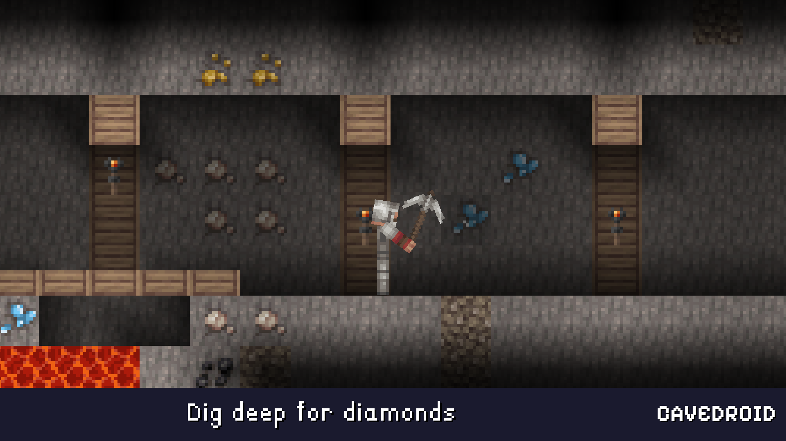
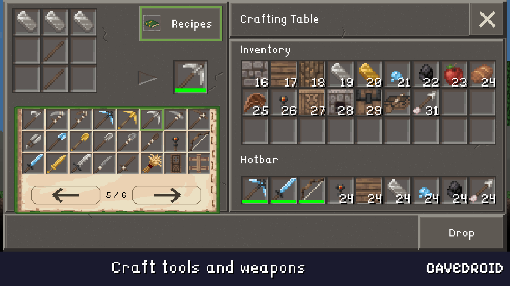
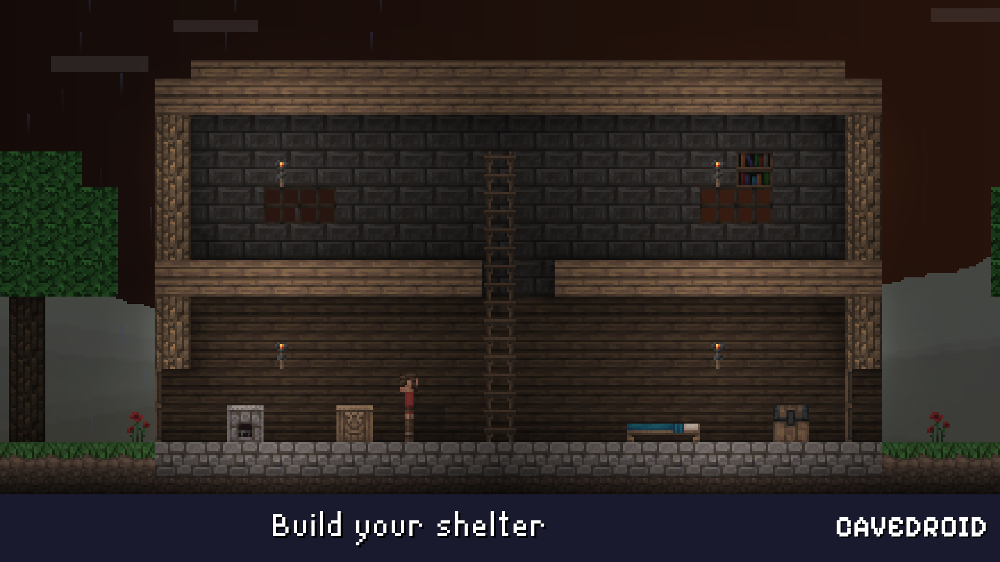

[English](README.md) | [Русский](README-RU.md)


[](https://github.com/fredboy/cavedroid/actions/workflows/android.yml)
[](https://github.com/fredboy/cavedroid/actions/workflows/desktop.yml)
[](https://github.com/fredboy/cavedroid/actions/workflows/html.yml)
[](https://github.com/fredboy/cavedroid/actions/workflows/ktlint.yml)
[](https://github.com/fredboy/cavedroid/releases)

CaveDroid is a **2D Minecraft-inspired game** for Android, Desktop (Windows, Linux, macOS), Web (browser), and potentially iOS.
Explore, mine, and build in procedurally generated worlds.

<details>
  <summary>Screenshots</summary>









</details>

---

## Features

- **Game modes:** Survival with health and hunger; Creative with unlimited blocks and flight. Single-player, playable offline.
- **Exploration:** procedurally generated infinite worlds with biomes, caves, mineshafts and villages. Craft boats to travel across water.
- **Crafting and building:** mine and smelt ores, craft tools and blocks, furnish houses and store supplies in chests.
- **Farming:** grow crops and cook food.
- **Combat:** zombies, skeletons, spiders and creepers; swords, bows, armor and TNT with chain explosions.
- **World simulation:** flowing water and lava, and spreading fire.
- **Lighting and weather:** day and night, torch lighting, rain, snow and freezing water in snowy biomes.
- **[Asset packs](ASSET_PACKS.md):** custom textures, sounds and game data on Android and desktop, including higher-resolution textures.
- **Saves:** multiple worlds, save export and import.
- **Statistics:** play time, blocks mined, items crafted and other gameplay activity.

---

## Controls

| Action | Touch / Mobile | Keyboard / Mouse |
|--------|----------------|-----------------|
| Move left/right | Drag **joystick** on left half | **A / D** |
| Jump | Tap left side or press **jump button** | **Space** (jump mid-air in Creative = fly) |
| Move cursor / aim | Drag on right side | Move **mouse** |
| Break block | Hold right side | **LMB** while aiming at block |
| Place block (background layer) | Hold right side while aiming empty cell | **RMB** while aiming empty space |
| Activate / Use / Place active block | Tap right side | **RMB click** |
| Attack mob | Tap while aiming at mob | **LMB click** |
| Open inventory | Chest button | **E** |
| Inventory: pick up / move | Drag-n-drop, tap | Click to pick up, Right-click for half stack or place single item |
| Inventory: move single item (touch) | Hold item with one finger + tap target cell with another | N/A |

---

## Download

<p>
  <a href="https://play.google.com/store/apps/details?id=ru.fredboy.cavedroid">
    
  </a>
</p>


You can also download Android and desktop builds from [the releases page](https://github.com/fredboy/cavedroid/releases).
Or play right from your browser [on GitHubPages](https://fredboy.github.io/cavedroid).

---

## Build

Install **JDK 25** and set `JAVA_HOME` and your IDE Gradle JVM to it.
Android builds also need the Android SDK. Run the Gradle wrapper from the repository root:

| Task | Command |
| --- | --- |
| Run desktop | `./gradlew desktop:run` |
| Desktop JAR | `./gradlew desktop:dist` |
| FOSS debug APK | `./gradlew android:assembleFossDebug` |
| Run web (JavaScript / Wasm GC) | `./gradlew html:runWeb` / `./gradlew html:runWasm` |
| Web ZIP for static hosting (JavaScript / Wasm GC) | `./gradlew html:packageWebDist` / `./gradlew html:packageWebDistWasm` |

The web target uses [gdx-teavm](https://github.com/xpenatan/gdx-teavm).
Wasm requires a browser with WebAssembly GC support; JavaScript builds support finite worlds only.
See each module's `build.gradle.kts` for additional build tasks.

On Windows, use `gradlew.bat` and ensure the asset symlinks resolve correctly.

For signed builds, create `keystore.properties` at the repository root:

```properties
releaseKeystorePath=/path/to/keystore.jks
releaseKeystorePassword=...
releaseKeyAlias=...
releaseKeyPassword=...
```

Keep keys and passwords out of Git. See [CONTRIBUTING.md](CONTRIBUTING.md) for contribution and verification guidance.

## Asset packs

See [Creating asset packs](ASSET_PACKS.md) for the ZIP format and override rules.

## License

### Code
CaveDroid is licensed under the **MIT License**. See [LICENSE](LICENSE) for details.

### Assets

- **Textures**: Pixel Perfection by XSSheep, licensed under [CC BY-SA 4.0](https://creativecommons.org/licenses/by-sa/4.0/)
- **On-screen joystick**: CC-0 from [OpenGameArt.org](https://opengameart.org/content/mmorpg-virtual-joysticks)
- **Font**: LanaPixel by eishiya, licensed under [CC BY 4.0](https://creativecommons.org/licenses/by/4.0/)
- **Scripts**: Various scripts from Stack Overflow are distributed under their applicable licenses

Licensed assets have an `attribution.txt` file in their directories with applicable attributions.

---

## Contributing

Contributions are welcome! Please open issues or pull requests for suggestions, bug fixes, or improvements.
